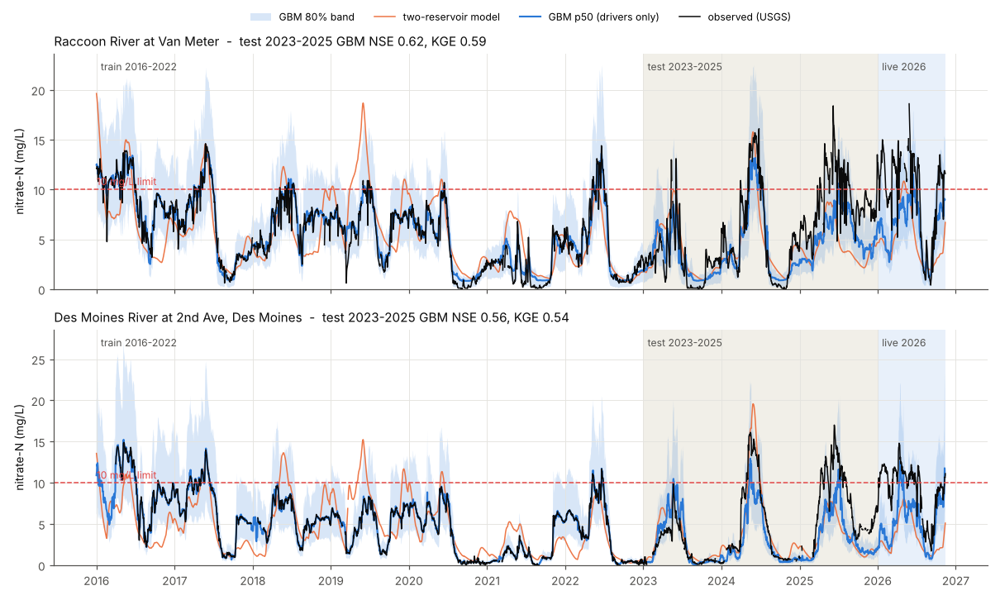
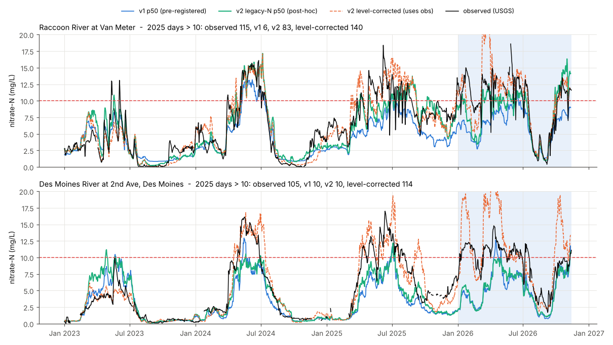
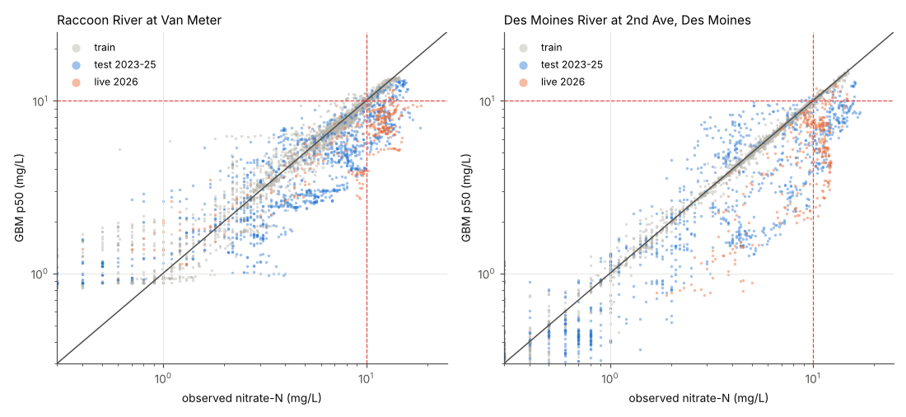
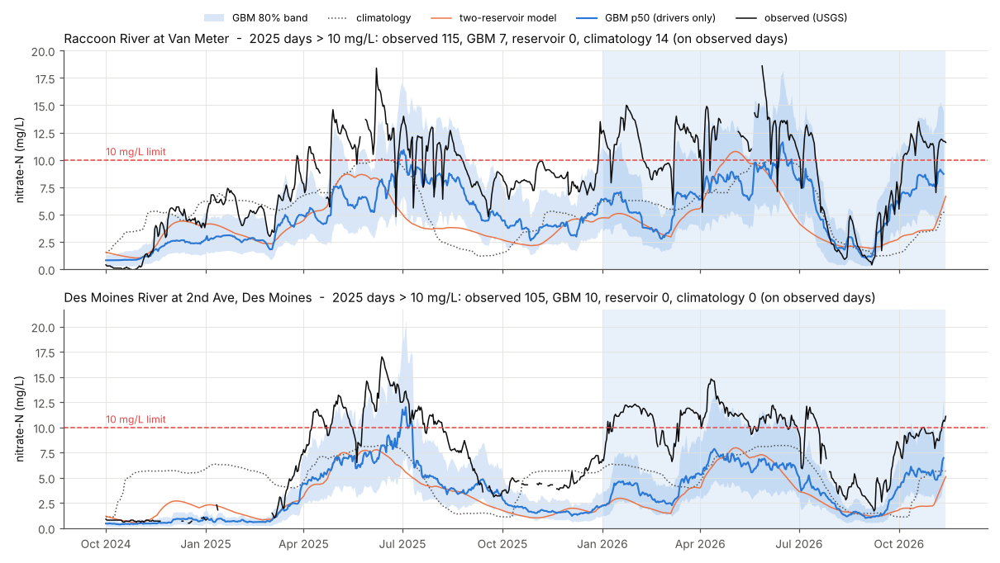
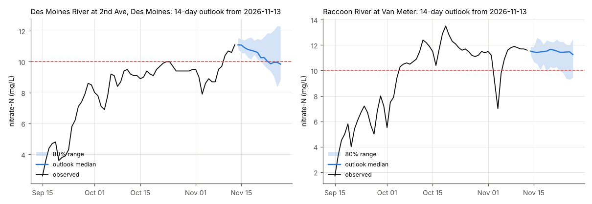
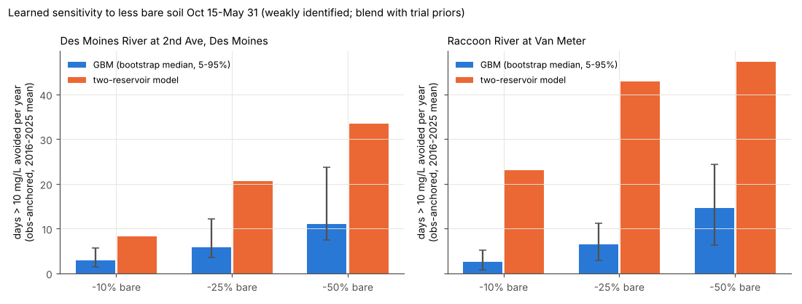

# Field to Faucet: validation

This file reports out-of-time tests against simple baselines. Every number below was read from the output files on
2026-11-14 (data through 2026-11-13 for USGS, 2026-11-11 for NASA POWER); §9 and the scenario rows were refreshed on
2026-11-15 after an independent science review (Bayesian bootstrap, real-run-day plant rule, trials-only results):

- `model/out/metrics.json` (river models, outlook, v2, display rule)
- `model/out/sensitivity.json` (learned response to less bare soil)
- `model/out/basin_index_check.json` (field and sub-watershed leak index)
- `data/processed/hls_vs_modis.json`, `cover_hls_calibration.json`, `imerg_vs_power.json`
- `web/data/scenarios.json` → `thresholds.calibration` (removal-plant and ban proxies)

Where a module note (`notes/*.md`) disagrees with these files, the files win. Known disagreements are listed at the end.

**Short version.**
1. The pre-registered model (v1) beats climatology and a conceptual model on 2023-2025, years it never saw (NSE 0.62
   and 0.56 against 0.30 and 0.27), but it badly misses the 2025 crisis (6 modelled days above 10 mg/L against 115
   measured on the Raccoon River at Van Meter, upstream of the intake).
2. A second model (v2) built after that miss recovers most of 2025 at the Raccoon (83 of 115 days) and passes a blind
   2013 check, but it does not help at the Des Moines River, and its test scores are post-hoc.
3. Because of (1), the app never uses a modelled absolute level for impact numbers. Scenarios apply a relative change to
   the measured river.
4. What the river can test is water-driven timing and level. It cannot test how much a practice cuts nitrate. Those
   effects come from Iowa field trials, and we say so wherever they are shown.

---

## 1. Set-up

| item | value |
|---|---|
| Target | Daily mean nitrate + nitrite (USGS parameter 99133, mg/L as N) at Raccoon River at Van Meter (USGS 05484500, the main intake river) and Des Moines River at 2nd Ave (USGS 05482000, below Saylorville Reservoir) |
| Inputs to the simulation | NASA POWER rain, root-zone and surface soil wetness (GWETROOT, GWETTOP), snow depth, temperature; MODIS 13Q1 bare-soil share of row-crop land (causal "as-of" values, Jul-Nov 2025 filled from HLS); CDL corn share; USGS discharge. **Measured nitrate is never an input.** |
| Model | Monotone quantile LightGBM (p10/p50/p90; non-decreasing in bare share and soil wetness), 80% band widened by conformal (CQR) leave-one-year-out residuals |
| Splits (fixed in the project spec before any model was fitted) | train 2016-2022, **test 2023-2025**, live 2026-01-01 to 2026-11-13 |
| Baselines | day-of-year climatology (2016-2022); a two-reservoir conceptual nitrate model fitted on the same years; persistence 7 d and 14 d (these use measured nitrate, so they are forecasts, not simulations) |
| Scoring | concentration in mg/L on days with an observation; NSE, KGE, RMSE, 80% band coverage, days above 10 mg/L (EPA limit), CSI at 10 mg/L |

v2 ("legacy N") adds a causal nitrogen carry-over store: S_t = S_{t-1}·exp(−D_t/k) + spring corn-share input, with
drainage D = rain × GWETROOT². The store builds up in dry years and is flushed when soils re-wet. For the Raccoon, v2
also trains on 2012-2022 (USGS nitrate there starts 2012-03-02). v2 was designed **after** seeing the v1 2025 miss, so
its 2023-2025 and 2026 scores are post-hoc.

## 2. River simulation: v1 (pre-registered) and v2 (post-hoc), side by side

"Days > 10" = measured / modelled days above 10 mg/L, counted on days that have both a measurement and a prediction.

### Raccoon River at Van Meter (05484500)

| split | model | NSE | KGE | RMSE mg/L | 80% band coverage | days > 10 meas. / model | CSI |
|---|---|---|---|---|---|---|---|
| test 2023-25 | **v1 GBM (pre-registered)** | **0.62** | 0.59 | 2.60 | 0.66 | 189 / 64 | 0.32 |
| test 2023-25 | v2 GBM (post-hoc) | 0.78 | 0.87 | 1.96 | 0.80 | 189 / 154 | 0.52 |
| test 2023-25 | two-reservoir model | 0.38 | 0.49 | 3.33 | 0.55 | 189 / 42 | 0.22 |
| test 2023-25 | climatology | 0.30 | 0.41 | 3.52 | 0.65 | 189 / 42 | 0.14 |
| test 2023-25 | persistence 7 d (uses measured nitrate) | 0.77 | 0.88 | 2.01 | – | 179 / 181 | 0.61 |
| test 2023-25 | persistence 14 d (uses measured nitrate) | 0.66 | 0.83 | 2.41 | – | 177 / 179 | 0.53 |
| live 2026 | v1 GBM | −0.09 | 0.43 | 4.34 | 0.60 | 174 / 7 | 0.04 |
| live 2026 | v2 GBM (post-hoc) | 0.48 | 0.72 | 3.00 | 0.89 | 174 / 121 | 0.62 |
| live 2026 | climatology | −0.49 | 0.38 | 5.05 | 0.51 | 176 / 14 | 0.07 |
| live 2026 | persistence 7 d | 0.64 | 0.82 | 2.50 | – | 167 / 164 | 0.71 |

### Des Moines River at 2nd Ave (05482000)

| split | model | NSE | KGE | RMSE mg/L | 80% band coverage | days > 10 meas. / model | CSI |
|---|---|---|---|---|---|---|---|
| test 2023-25 | **v1 GBM (pre-registered)** | **0.56** | 0.54 | 2.97 | 0.64 | 166 / 25 | 0.12 |
| test 2023-25 | v2 GBM (post-hoc) | 0.59 | 0.62 | 2.88 | 0.50 | 166 / 22 | 0.07 |
| test 2023-25 | two-reservoir model | 0.54 | 0.68 | 3.03 | 0.73 | 166 / 57 | 0.32 |
| test 2023-25 | climatology | 0.27 | 0.32 | 3.81 | 0.77 | 166 / 0 | 0 |
| test 2023-25 | persistence 7 d | 0.90 | 0.95 | 1.43 | – | 166 / 167 | 0.72 |
| test 2023-25 | persistence 14 d | 0.80 | 0.90 | 2.04 | – | 166 / 167 | 0.60 |
| live 2026 | v1 GBM | −1.31 | 0.46 | 4.54 | 0.49 | 156 / 17 | 0.11 |
| live 2026 | v2 GBM (post-hoc) | −1.18 | 0.47 | 4.41 | 0.44 | 156 / 4 | 0.02 |
| live 2026 | climatology | −1.35 | 0.44 | 4.57 | 0.47 | 158 / 0 | 0 |
| live 2026 | persistence 7 d | 0.68 | 0.84 | 1.69 | – | 158 / 155 | 0.66 |

Leave-one-year-out cross-validated NSE inside the training years: v1 0.73 (Raccoon) and 0.60 (Des Moines); v2 0.60 and
0.76. The in-sample training fits (NSE 0.96-0.997) are not a measure of skill and are not shown in the app.

Test NSE by year (it is not uniform):

| site | model | 2023 | 2024 | 2025 |
|---|---|---|---|---|
| Raccoon | v1 | 0.59 | 0.85 | −0.85 |
| Raccoon | v2 | 0.57 | 0.88 | 0.18 |
| Des Moines | v1 | 0.51 | 0.71 | −0.24 |
| Des Moines | v2 | −0.12 | 0.74 | 0.03 |

How to read this:
- v1 beats climatology and the conceptual model at both sites on the test years. It loses to 7-day persistence, which
  is expected: persistence is handed last week's measurement. The simulation's job is to explain nitrate from
  drivers, so that a what-if on the drivers means something.
- The 80% band is too narrow out of sample for v1 (0.66 and 0.64 coverage instead of 0.80).
- 2026 is bad for every driver-only model at the Des Moines River. Saylorville Reservoir routing is not modelled, and
  the 2026 level sits far above what the drivers explain.

## 3. The 2025 crisis

Days above 10 mg/L in 2025, counted on measured days.

| | Raccoon (05484500) | Des Moines (05482000) |
|---|---|---|
| measured | **115** of 356 measured days (first 2025-03-26; still above 10 on 2025-12-31) | **105** of 287 measured days (2025-04-09 to 2025-08-06; no data Jan-Feb) |
| v1 GBM median (pre-registered) | **6** (6 hits, 109 misses) | **10** |
| v1 upper 80% bound above 10 | 121 days | 87 days |
| v2 GBM median (post-hoc) | **83** (55 hits, 60 misses, 28 false alarms) | **10** |
| v2 upper 80% bound above 10 | 280 days | 97 days |
| two-reservoir model | 0 | 0 |
| climatology | 14 | 0 |
| level-corrected v2 / v1 (uses 60 days of measured nitrate) | 140 / 133 | 114 / 99 |
| measured peak (daily mean) | 18.4 mg/L on 2025-06-07 | 17.0 mg/L on 2025-06-12 |
| v1 / v2 modelled peak | 10.6 / 13.7 | 11.6 / 12.2 |

2026 (live, through 2026-11-13): Raccoon 176 measured days above 10, v1 7, v2 121 (on days with a prediction: 174
measured); Des Moines 158 measured, v1 17, v2 4.

**Why v1 misses: what we know and what we do not.**
- Year-level ratios of measured to modelled nitrate (v1, out of fold) range ×0.67-1.36 at the Raccoon and ×0.73-1.46
  at the Des Moines River over the training years. 2025 sits at ×1.68 and ×2.07; 2026 at ×1.53 and ×1.83.
- The 2025 values are USGS-approved, so this is not a provisional-data artifact (provisional values start 2026-06-02
  at both sites).
- Candidate causes: nitrogen left in soils and groundwater after the 2020-2023 drought; changes in N rates or
  management (not observed); long groundwater residence; a level shift in POWER rain when it moved to GEOS-IT for
  recent months (not checked).
- Evidence against drought carry-over as the sole cause: 2023, right after the 2022 drought, ran *low* (×0.89 and
  ×0.86). The prior-year flow anomaly is only weakly related to the annual residual (r −0.36 to −0.56, p 0.12-0.35,
  n = 9). **We treat legacy nitrogen as a hypothesis, not a finding.**

**What we learned and changed.**
1. The model is used for relative changes (what-ifs), applied to the measured river. Its absolute 2025 level is never
   used for an impact count.
2. Near-term levels come from the 14-day outlook, which starts from the latest measurement (§7).
3. v2 was built and tested with the extra checks in §4-§5, and a display rule (§6) was fixed before any v2 2026 metric
   was computed; v1's 2026 miss was already known (v1's 2026 results were committed before v2 was designed).

## 4. Blind 2013 check (Raccoon, pre-registered)

2013 was chosen by the verifier **before v2 was fitted** as the closest analog of 2025: the flush after the 2012
drought. v2's hyperparameters and carry-over constant k were chosen by leave-one-year-out CV with 2013 excluded.

| | days > 10 mg/L | NSE | KGE | peak mg/L | ln-RMSE |
|---|---|---|---|---|---|
| measured (236 measured days) | **92** | | | 20.5 | |
| v2 | 81 | 0.85 | 0.73 | 19.4 | 0.97 |
| v1 feature set, trained on the same longer record | 80 | 0.79 | 0.66 | 15.3 | 0.56 |

v2 reproduces 2013, but so does the v1 feature set once 2012, 2014 and 2015 are in training. Most of the 2013 skill
comes from the longer record, not from the carry-over store, and the store is worse in log error (more error at low
concentrations).

## 5. Strict check: train 2012-2019, test 2020-2025

Train on 2012-2019 (Raccoon) or 2016-2019 (Des Moines), with no 2020-2022 data; score 2020-2025. ln-RMSE (lower is
better) / NSE.

| site | model | 2020-22 | 2023-25 | 2020-25 | days > 10 in 2023-25, meas. / model |
|---|---|---|---|---|---|
| Raccoon | v2 | 0.65 / 0.65 | 0.83 / 0.60 | **0.75** / 0.64 | 191 / 36 |
| Raccoon | v1 features, same years | 0.96 / 0.45 | 1.02 / 0.44 | 0.99 / 0.48 | 191 / 0 |
| Raccoon | v1 features, 2016-19 only | 1.12 / 0.63 | 1.13 / 0.45 | 1.12 / 0.55 | 191 / 7 |
| Des Moines | v2 | 1.32 / 0.69 | 1.06 / 0.50 | **1.20** / 0.58 | 167 / 31 |
| Des Moines | v1 features, same years | 1.40 / 0.35 | 1.05 / 0.52 | 1.25 / 0.49 | 167 / 36 |

v2 improves log error at both sites, clearly at the Raccoon and marginally at the Des Moines River. But under this
check the Raccoon v2 catches only 36 of 191 days above 10 in 2023-2025. **Much of v2's 2025 skill needs the 2020-2022
training years.**

## 6. Display-model rule (fixed before any v2 2026 metric was computed; v1's 2026 miss was already known)

Timing, stated exactly: the rule was fixed before any v2 2026 metric was computed, but v1's 2026 results, including its
2026 miss, had already been committed before v2 was designed. The flag `decided_before_2026_metrics: true` in
`metrics.json` means "before any v2 2026 metric" (`display_model.timing_note`). The rule itself does not use 2026 data.

Rule (`metrics.json → display_model`): use v2 at a site if and only if
(a) v2's leave-one-year-out CV ln-RMSE over the 2016-2022 folds is no worse than v1's, **and** (b) v2 improves the
pooled 2020-2025 ln-RMSE of the strict check.

| site | CV ln-RMSE v2 / v1 | strict ln-RMSE v2 / v1 | result |
|---|---|---|---|
| Raccoon | 0.519 / 0.527 | 0.748 / 0.987 | v2 |
| Des Moines | 0.463 / 0.522 | 1.203 / 1.250 | v2 (marginal; read it as "about v1") |

The river chart in the app shows v2 at both sites. The scenario engine does **not** depend on this choice: it uses the
measured river and the v1 learned response (§9).

## 7. 14-day outlook against persistence

LightGBM quantile models of ln(nitrate[t+h] / nitrate[t]) for h = 1-14 days. Inputs: last measured nitrate and its
3- and 7-day change, flow, season, and drivers as of t−2 days. **No weather forecast is used.** Test = models trained
2016-2022, scored 2023-2025; live = trained 2016-2025, scored 2026.

| site | period | lead | RMSE: outlook / persistence / climatology of change | MSE skill vs persistence | Brier skill (> 10 mg/L) vs probabilistic persistence | [vs deterministic persistence] |
|---|---|---|---|---|---|---|
| Raccoon | test 2023-25 | 7 d | 1.81 / 2.02 / 1.99 | +20% | +0.13 | [+0.34] |
| Raccoon | test 2023-25 | 14 d | 2.11 / 2.44 / 2.35 | +25% | **+0.03** | [+0.29] |
| Raccoon | live 2026 | 7 d | 1.96 / 2.48 / 2.33 | +38% | +0.21 | [+0.38] |
| Raccoon | live 2026 | 14 d | 2.66 / 3.50 / 3.00 | +42% | +0.04 | [+0.31] |
| Des Moines | test 2023-25 | 7 d | 1.14 / 1.44 / 1.46 | +37% | +0.19 | [+0.41] |
| Des Moines | test 2023-25 | 14 d | 1.90 / 2.08 / 2.06 | +17% | **−0.04** | [+0.28] |
| Des Moines | live 2026 | 7 d | 1.34 / 1.68 / 1.61 | +36% | +0.22 | [+0.45] |
| Des Moines | live 2026 | 14 d | 2.01 / 2.24 / 2.05 | +20% | −0.02 | [+0.30] |

- In squared error the outlook beats "no change" at every lead shown.
- **It has no probability skill at 14 days.** Against probabilistic persistence (last value ± the training-period spread
  of h-day changes) the Brier skill is +0.03 and −0.04. The bracketed skill against deterministic persistence is
  inflated and is not the claim.
- Raw 80% bands were too narrow on the test years (Raccoon 0.61 at 7 d, 0.55 at 14 d). They are widened per lead by a
  factor fitted on 2023-2025; with that factor they covered 0.82 / 0.74 (Raccoon 7 d / 14 d) and 0.79 / 0.81 (Des
  Moines) on live 2026.
- Exceedance CSI at 14 days is about equal to persistence (Raccoon test 0.51 vs 0.52; Des Moines 0.53 vs 0.59).

## 8. Field and sub-watershed leak index

The leak index is bare share × wet-soil drainage × a soil-drainage factor, summed over days. It is calibrated each year
so that sub-watersheds and fields add up to the measured river load. The calibration makes the basin totals match by
construction, so the only independent test is whether the **uncalibrated** index tracks measured annual load per
row-crop hectare across 2016-2025 (2 basins × 10 years, n = 20).

| predictor of annual load per row-crop ha | Pearson r | Spearman |
|---|---|---|
| leak index (bare × wet drainage × soil) | **0.75** (p = 1.3e-4) | 0.84 |
| drainage only, no cover term | 0.79 | 0.90 |
| NASA POWER precipitation only | 0.83 | 0.83 |
| measured runoff (reference, not a predictor) | 0.87 | 0.93 |

**Plainly:** the index tracks year-to-year load (r ≈ 0.75), but **no better than water alone**. The bare-soil term
does not add interannual skill: the partial correlation of the cover part with load, controlling for drainage, is
**negative (r = −0.39, p = 0.09)**. Pooled r rises from 0.71 with no bare-soil weighting (ε = 0) to 0.75 at the value we
use (ε = 0.232) to 0.79 when cover is ignored (ε = 1). Year-to-year MODIS bare share is mostly green-up timing, which is
weather. The size of the cover effect in the index is set from Iowa trials (ε is calibrated so HLS-detected cover
fields leak 28% less, the INRS 2024 cereal-rye efficiency), not learned from the river.

Other checks:
- Drainage driver (rain + snowmelt gated by root-zone wetness above 0.45) against measured runoff: monthly r 0.91 at both
  basins, annual r 0.95 / 0.96 (without the wetness gate: 0.64 / 0.70 monthly).
- Raccoon / Des Moines per-area ratio: index 0.72, measured 0.88; year-to-year correlation of the ratios r = 0.36
  (n.s.). The index misses the between-basin level; per-basin calibration absorbs it.
- Sub-watershed ranking is insensitive to the tile-drainage multiplier m (Spearman ≥ 0.975 for m = 1 to 4).
- Load gap-filling: hiding 3-90-day blocks gives a relative RMSE of 16-31% (Raccoon) and 7-24% (Des Moines) per block;
  annual load SD ≤ 2.5%, except Des Moines 2016 at 7.9%.

## 9. Learned response to less bare soil (used in scenarios, weakly identified)

Cutting the daily bare share by 25% on Oct 15-May 31 changes modelled concentration, **given the observed flow**, by:

| model | site | Δ nitrate in window, central (bootstrap 5-95%) | days > 10 avoided per year 2016-25, central (bootstrap 5-95%) | LOYO ln-RMSE gain from bare-soil features |
|---|---|---|---|---|
| v1 | Raccoon | −4.1% (−5.9 to −2.9%) | 3.8 (2.5-11.0) | 0.005 |
| v1 | Des Moines | −8.0% (−13.9 to −7.2%) | 10.6 (6.6-18.5) | 0.002 |
| v2 | Raccoon | −9.6% (−15.4 to −9.7%) | 11.3 (11.7-21.1) | 0.002 |
| v2 | Des Moines | −5.6% (−12.4 to −6.2%) | 5.2 (4.3-12.0) | 0.009 |

"Central" is the deployed model. The bootstrap is 30 **Bayesian-bootstrap** refits over the training years (v1:
2016-2022; v2: Raccoon 2012-2022, Des Moines 2016-2022): Dirichlet(1) weights per year passed to LightGBM as row
weights, with no row duplication. Both are mostly in-sample.
- **Bootstrap fix.** The earlier bootstrap duplicated the rows of a resampled year, so a year drawn twice counted twice
  against `min_child_samples` and loosened the trees. Its v2 Raccoon range (−18.0 to −10.6%) excluded the central
  −9.6%. It is now −15.4 to −9.7%. The v1 ranges, which the scenarios use, now contain their central values at every
  level (`sensitivity.json → gbm.<frac>.bootstrap.central_inside_5_95`).
- **The v2 centrals still sit at or just outside the edge** (Raccoon −9.6 vs −9.7; Des Moines −5.6 vs −6.2). The deployed
  model is one seed: refits on all training years with five other seeds give −9.8 to −10.5% (Raccoon) and −5.8 to −8.1%
  (Des Moines) (`seed_spread_all_years`), so seed 7 sits at the weak end. Reweighted refits also rarely give a smaller
  effect than the full-data fit, so the bootstrap leans toward larger effects.
- **The bare-soil features add no tested skill.** Including them improves leave-one-year-out ln-RMSE by only
  0.002-0.009, i.e. well under 1%. v1 and v2 also differ by a factor of about 3 at the Raccoon. The effect size is not
  pinned down by the river data.

Why it is weakly identified:
- 97-98% of bare-share variance in training is the seasonal cycle; the Oct-May mean varies between years with an SD of
  only 0.019-0.025.
- A 10% cut is already 3.6-4.8 interannual SDs and leaves the training range on 44-63% of window days (a 25% cut: 72-78%;
  a 50% cut: 87-90%). Trees extrapolate flat there, so the response saturates.
- Flow features carry 38-52% of the model's gain, and cover crops can also reduce drainage volume, so these are
  concentration changes, not load changes.

This is why the scenario engine gives equal weight to this river-model path and to the Iowa trial prior (INRS 2024:
cereal rye 28% mean cut in drainage nitrate, SD 26), reports the mixture's 10th-90th percentile, and exports a
**trials-only** result next to it for every year and level. The river-model path drives most of the mixture's plant-day
effect (2025 at 25%: 17 (7-33) avoided plant days river-model only, 10 (2-36) trials only, 16 (3-34) mixture), so
trials-only is the trial-anchored figure.

## 10. Supporting data checks

### HLS (30 m) vs MODIS (250 m) living share, 10 focus HUC-12s, 2020-2026

| comparison | n | r | bias (MODIS − HLS) |
|---|---|---|---|
| all HUC-12 × composite pairs | 2,270 | 0.94 | +0.085 (same living/bare class 93.8%) |
| deseasonalized | 2,270 | **0.63** | 0 |
| fall window (Oct 15-Dec 15) | 347 | 0.83 | +0.04 |
| spring window (Mar 15-May 10) | 439 | 0.52 | +0.13 |
| Mar-May | 668 | 0.49 | +0.17 |
| HUC-12 ranking, Apr-May means (10 HUC-12s) | 10 | 0.94 (Spearman 0.84) | MODIS 0.22-0.37 vs HLS 0.02-0.07 |
| HUC-12 ranking, per composite (Apr-May) | 46 composites | Spearman median 0.55 | |

Conclusion: MODIS ranks HUC-12s well but overstates spring living cover in absolute terms (16-day maximum-value
compositing and 250 m mixed pixels). We use MODIS as a relative index for the watershed and HLS for absolute
field-level bare share.

### HLS gap-fill of the missing Jul-Nov 2025 MODIS composites

HLS composites built on the MODIS windows, quantile-mapped to MODIS NDVI (2023, 2024 and two 2025 bracketing windows;
76 basin-composites, 11.2 M pixel pairs):

| living share at NDVI 0.30, basin level | bias HLS − MODIS | r | RMSE |
|---|---|---|---|
| raw HLS | +0.055 | 0.987 | 0.100 |
| quantile-mapped | −0.001 | 0.989 | 0.062 |
| leave-one-year-out mapping | −0.002 | 0.977 | 0.086 |
| leave-one-year-out, fall composites only (n = 32) | −0.006 | 0.883 | 0.132 |

### NASA POWER rain vs GPM IMERG, 38 storm days 2016-2021 (76 basin-days)

The days were chosen because POWER was wet, so the sample is range-restricted and says nothing about storms POWER missed.

| subset | n | r | volume ratio POWER/IMERG | RMSE mm |
|---|---|---|---|---|
| pooled | 76 | 0.62 | 1.01 | 9.6 |
| Raccoon | 38 | 0.60 | 1.00 | 9.2 |
| Des Moines | 38 | 0.64 | 1.02 | 9.9 |

POWER matches IMERG volumes on these days but compresses extremes (OLS slope 0.48). Daily totals explain only about 37%
of the variance of log peak 30-minute intensity (r = 0.61), so storm intensity is not recoverable from POWER. The models
use daily rain and antecedent wetness, not intensity.

### Removal-plant and watering-ban proxy rules (fit 2025, test 2026)

The utility's operating rules are not public, so the scenarios use proxies.

| rule | period | proxy days | reported days | hits / false alarms / misses | daily F1 |
|---|---|---|---|---|---|
| plant: 7-day mean of the two rivers' average > 10.2 mg/L | 2025 fit | 106 | 112 | 102 / 4 / 10 | 0.94 |
| same rule, no refit | **2026 test (Jan-Jul)** | 157 | 193 | 157 / 0 / 36 | **0.90** |
| ban: Jun-Aug, plant proxy on and both rivers' 7-day mean > 10 mg/L (not fitted) | 2025 | 66 | 56 (all customers) | 53 / 13 / 3 | 0.87 |
| same rule | **2026 test** | 40 | 42 | 33 / 7 / 9 | **0.81** |

- In 2026 the plant proxy never ran when the utility did not, but it missed 36 shoulder days: the utility ran earlier
  and longer than a 2025-fitted rule predicts. The Monte Carlo draws the threshold from 9.4-10.2 mg/L (every value whose
  2025 F1 is within 0.025 of the best).
- The proxy turns the plant on for 23 days in Oct-Nov 2026; no fall restart had been reported when facts were checked,
  so these are probably false alarms.
- **Scenario plant days count only real run days.** In 2025 and 2026 a plant day counts only where the proxy is on and
  the plant really ran (reported run windows), so avoided plant days are real run days the scenario switches off; Oct-Nov
  2026 proxy days never count. Before this fix only about 15 of the 23 avoided 2025 days fell inside the real run, and
  4 of the 19 avoided 2026 days were Aug-Nov days when the plant was off.
- The ban proxy starts on 1 June in both years (real starts: 12 June 2025, 8 June 2026).
- A ban start threshold fitted to 2025 (lower river > 13.25 mg/L) fits 2025 almost exactly (F1 0.98) and finds **no
  ban at all** in 2026. It was rejected as over-fitted. Ban-day changes in the app are labelled indicative.

## 11. What is NOT validated

| claim area | status | why |
|---|---|---|
| **HUC-12 hotspot ranking** within a basin | not validated | No sub-basin nitrate gauges. In the Raccoon the ranking follows bare-and-wet days (r = 0.80), which come mostly from 50 km POWER weather, more than poorly drained share (r = 0.06). Shown as "where bare ground meets wet soil", not as measured sources. |
| **Field-level leak** (lb N/acre/yr) | not validated against field data | A "field" is a 400 m grid cell; N rate, manure, tile layout and tillage are unknown. Values are the river load shared out by the index. |
| **Practice effects** (rye, extended rotation, prairie) | from trials, not from our data | The river record contains almost no change in cover adoption to learn from. Effect sizes come from INRS 2024 practice efficiencies (cereal rye 28% ± 26; 4-year rotation 27% ± 25; land retirement 85% ± 9). |
| **Scenario results** (days, plant days, $, ban days avoided) | not validated (counterfactual) | They combine trial priors with a river-model response whose bare-soil features add no tested skill, applied to the measured river through proxy rules. Trials-only results are shown alongside. They describe a fully developed effect replayed on 2025 weather; legacy nitrogen means a real change takes more than one season. |
| **Cover-crop adoption** from HLS | lower bound only | 0.8-4.2% of field-winters a year are detected against about 17% statewide adoption. HLS sees only cover that has grown enough by late fall or early spring; covers drilled late or that stay small (below NDVI 0.30) are missed. |
| **Outlook probabilities** at 14 days | no skill | Brier skill against probabilistic persistence +0.03 / −0.04 (test). |

## 12. Disagreements found between module notes and the output files

- Scenario numbers changed on 2026-11-15 (review fixes). `web/data/scenarios.json` now gives, at 25%, 2025 mixture:
  Raccoon days 7 (2-16), Des Moines days 21 (5-36), plant days 16 (3-34), $234k ($47k-507k), ban days 23 (9-31); trials
  only: 9 (1-21), 13 (2-28), 10 (2-36), $157k ($29k-534k), 17 (2-28). 2026 mixture: 5 (4-22), 30 (11-56), 14 (4-29),
  $209k ($64k-444k), 16 (1-26); trials only: 12 (1-30), 21 (7-71), 14 (2-37), $218k ($29k-564k), 12 (0-29). Nitrogen
  kept at the gauges, 2025 at 25%: 6.5 million lb (2.1-9.9 million) mixture, 4.8 million lb (1.1-10.5 million) trials
  only. Cost at the Q1-2026 daily rate: $134k ($25k-284k). The earlier
  run (proxy-on plant days) gave 2025 plant days 23 (5-41), $350k. `notes/scenarios.md` §4 was regenerated from the JSON.
- `facts.json → plant_cost_per_day_usd.range.lo` = $4,000 has no quote behind it (the CIWW page gives only the $16,000
  full-capacity figure). The scenarios do not use it; cost per day stays U[$14,286, $16,000].
- `notes/hydro.md` and the app caveats say USGS data are provisional from about mid-2025; the current NWIS pull has
  provisional (`P`) nitrate only from 2026-06-02 at both sites.
- The strict check counts 191 measured days above 10 in 2023-2025 at the Raccoon; the test split counts 189 (6 + 68 +
  115). The strict-check count is on days with a prediction from a different training run; we report both as stored.
